<p align="center">
  
</p>

<p align="center">
  
  
  
  
  
</p>

<p align="center">
  A fast, dependency-free recreation of the <a href="https://intoaec.ai/discovery-call/">IntoAEC Discovery Call</a> page,
  built to score 90+ on PageSpeed and keep the booking calendar out of the critical path.
</p>

<p align="center"></p>

## How it works

The expensive part of the original page is the TidyCal booking widget. Here it is loaded **only when a visitor asks for it**.

<p align="center">
  
</p>

1. **The page loads fast.** Only HTML, one stylesheet and one small script. No third-party scripts in the initial load.
2. **The visitor clicks** *Choose a Date & Time* (or any *Book A Demo* button).
3. **TidyCal loads on demand.** The script is injected, the calendar replaces the CTA card in place, and a `book_demo_open` event is pushed to the dataLayer.

Hovering or focusing the button warms up the connection to TidyCal, so the calendar appears quickly once clicked. If the script fails to load, the visitor is sent to the TidyCal booking page instead, and the button is a normal link when JavaScript is off.

<p align="center"></p>

## Performance

<p align="center">
  
</p>

| Metric | Before | After (mobile) | After (desktop) |
|---|---|---|---|
| **Performance score** | 90 | **100** | **100** |
| First Contentful Paint | 2.6 s | 0.9 - 1.1 s | 0.2 s |
| Largest Contentful Paint | 2.7 s | 1.6 s | 0.4 s |
| Total Blocking Time | 0 ms | 0 - 30 ms | 0 ms |
| Cumulative Layout Shift | 0 | 0 | 0 |

> Measured locally with Lighthouse 12 (mobile and desktop presets) against a local static server. Re-run PageSpeed Insights on the live URL to confirm; hosting and any tags added in GTM will move the numbers a little.

**What made the difference**

- **Self-hosted Poppins** (Latin subset, 4 weights, ~8 KB each) preloaded from `fonts/`, instead of waiting on Google Fonts.
- **Metric-matched fallback font**, so text does not jump when Poppins swaps in (CLS stays at 0).
- **Right-sized WebP images** in `images/opt/` (about 53 KB total, down from about 215 KB), each with explicit `width` and `height`.
- **Lazy loading** for everything below the first screen; the header logo gets `fetchpriority="high"`.
- **TidyCal on click**, not on page load.
- **GTM that stays quiet** until a real container ID is set.

<p align="center"></p>

## Quick start

No install and no build step. Open `index.html` in a browser, or serve the folder:

```bash
npx http-server . -p 8080
# then open http://localhost:8080
```

TidyCal and Google Tag Manager need an internet connection to load.

## Configuration

### Google Tag Manager

Replace `GTM-XXXXXXX` in **two places** in `index.html`:

| Where | What it is |
|---|---|
| `<head>` script | The GTM loader |
| `<noscript>` right after `<body>` | Fallback for visitors without JavaScript |

Until a real ID is set, the loader exits early and makes no request to Google.

**dataLayer events** you can use as *Custom Event* triggers:

| Event | Fires when |
|---|---|
| `book_demo_open` | The visitor opens the TidyCal calendar |
| `newsletter_signup` | A valid email is submitted in the newsletter form |

`book_demo_open` means the calendar was opened, not that a booking was completed. To track completed bookings, use a thank-you redirect or TidyCal's own integrations.

### TidyCal booking link

The calendar path is set in two files:

- `script.js` - `data-path="book-a-demo/discovery-call"` in the `loadBooking` function
- `index.html` - the fallback `href` on the `#loadBooking` button

### Links

All navigation, footer, social and app-store links point to the live IntoAEC site. The source list is in [`Links.md`](Links.md).

<p align="center"></p>

## Project structure

```text
.
├── index.html          the page (GTM, nav, hero, booking CTA, newsletter, footer)
├── styles.css          all styles, including @font-face for Poppins
├── script.js           mobile nav, TidyCal on-demand loader, accordions, dataLayer events
├── fonts/              Poppins woff2 files (Latin subset)
├── images/
│   └── opt/            optimised WebP images actually used by the page
├── assets/             animated pixel-art SVGs used in this README
├── tools/
│   └── generate-art.js generator for the files in assets/
└── Links.md            reference list of the external links used on the page
```

## About the pixel art

The banner, flow diagram, scoreboard and runner above are hand-built SVGs with CSS animations: a 5x7 pixel font, stepped timing for a retro feel, and no JavaScript. They play inside a normal GitHub `` tag.

- Animations respect `prefers-reduced-motion` and show a static frame instead.
- To tweak colours, text or timing, edit `tools/generate-art.js` and run:

```bash
node tools/generate-art.js
```

<p align="center"></p>

<p align="center">
  <sub>Content and branding &copy; Siara Tech Solutions PTE LTD (IntoAEC). This repository is a performance-focused recreation of the public discovery call page.</sub>
</p>
